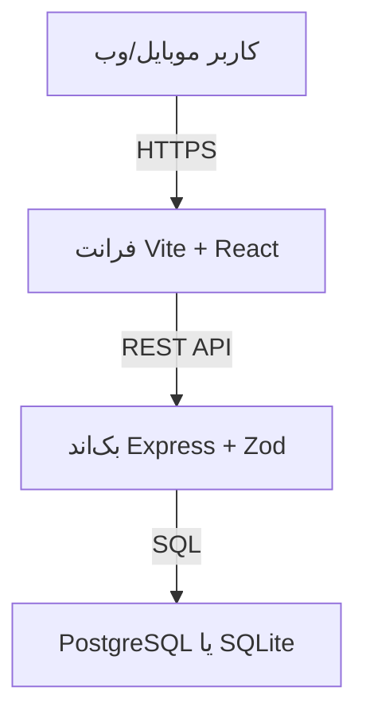

# میو‌دو (MeowDo) — مستندات معرفی، خودمیزبانی، سفارشی‌سازی و قیمت‌گذاری

> سند ارائه به مشتری — نسخه ۱٫۰ — مهر ۱۴۰۵ (اکتبر ۲۰۲۶)
> مخاطب: تیمی که قصد **خودمیزبانی (Self-Host)**، **سفارشی‌سازی** و مقایسه با **Trello** را دارد.

## فهرست

1. [میو‌دو چیست؟](#۱-میودو-چیست)
2. [ویژگی‌ها](#۲-ویژگیها)
3. [نقش‌ها و دسترسی‌ها](#۳-نقشها-و-دسترسیها)
4. [معماری و تکنولوژی‌ها](#۴-معماری-و-تکنولوژیها)
5. [خودمیزبانی (Self-Host)](#۵-خودمیزبانی-self-host)
6. [تنظیمات محیطی](#۶-تنظیمات-محیطی)
7. [به‌روزرسانی، پشتیبان‌گیری و امنیت](#۷-بهروزرسانی-پشتیبانگیری-و-امنیت)
8. [سفارشی‌سازی](#۸-سفارشیسازی)
9. [مرجع کوتاه API](#۹-مرجع-کوتاه-api)
10. [مقایسه با Trello و مسیر رسیدن به آن](#۱۰-مقایسه-با-trello-و-مسیر-رسیدن-به-آن)
11. [ویژگی‌های قابل سفارش](#۱۱-ویژگیهای-قابل-سفارش)
12. [قیمت‌گذاری](#۱۲-قیمتگذاری)
13. [پرسش‌های متداول](#۱۳-پرسشهای-متداول)
14. [گام بعدی](#۱۴-گام-بعدی)

---

## ۱- میو‌دو چیست؟

**میو‌دو** یک وب‌اپلیکیشن موبایل‌فرست برای مدیریت **هدف‌ها (Goals)**، **کارها (Tasks)** و **زمان (Time Tracking)** است. تفاوت اصلی آن با Trello:

| Trello | میو‌دو |
|---|---|
| برد و ستون و کارت؛ تمرکز روی «وضعیت کار» | هدف، بودجه زمانی و تایمر؛ تمرکز روی «امروز چه کار کنم و چقدر وقت بگذارم» |
| تایمر داخلی ضعیف (با افزونه) | تایمر شروع/توقف، ثبت دستی زمان، نمودار روزانه/ماهانه/سالانه |
| — | نمای **«امروز (Today)»**: تایمر جاری، کارهای عقب‌افتاده، سررسید امروز، بودجه روز |

به زبان یک‌خطی: **میو‌دو مثل یک مربی روزانه است؛ Trello مثل یک تابلوی دیواری.**

مشتریان هدف: افراد و فریلنسرها (نظم روزانه و ثبت ساعت کاری)، تیم‌های کوچک (اهداف مشترک و فضای اشتراکی)، سازمان‌هایی که می‌خواهند داده روی **سرور خودشان** باشد.

---

## ۲- ویژگی‌ها

### ۲٫۱ فضای کاری (Workspace)

- ساخت، ویرایش و حذف فضای کاری با نام و توضیحات
- **گروه‌بندی فضاها** (مثلاً «شخصی»، «کاری») با درگ‌دراپ در دسکتاپ و منوی «انتقال به گروه» در موبایل
- نمایش پیشرفت کلی، تعداد اهداف/کارها و علامت «تسک در حال اجرا» روی هر کارت

### ۲٫۲ هدف (Goal)

- هر هدف داخل یک فضای کاری: نام، توضیحات (با پشتیبانی از **مارک‌داون و نمودار Mermaid**)، ددلاین اختیاری، وضعیت (`pending` / `reached`)
- نوار پیشرفت بر اساس بودجه زمانی تسک‌ها + زمان ثبت‌شده

### ۲٫۳ کار (Task)

| فیلد | توضیح |
|---|---|
| نام و توضیحات | توضیحات با مارک‌داون/Mermaid |
| بودجه زمانی | به دقیقه؛ جمع روزانه نمایش داده می‌شود و اگر از ۲۴ ساعت بگذرد **هشدار** می‌دهد |
| وضعیت | `pending` ،`started` ،`failed` ،`done` — تغییر با یک کلیک «انجام شد» / «ناموفق شد» از منوی کارت |
| اولویت | عدد ۱ تا ۱۰؛ نمایش با ۱ تا ۳ شعله 🔥 |
| ددلاین | فقط وقتی نزدیک (≤۳ روز) یا عقب‌افتاده باشد روی کارت دیده می‌شود تا شلوغ نشود |
| تکرارشونده | کپی به روز بعد برای کارهای روتین |
| تایمر | `شروع` با یک کلیک، `توقف` با یک کلیک + امکان «اصلاح زمان پایان» |

### ۲٫۴ نمای «امروز» (Today)

مسیر پیش‌فرض بعد از ورود (`/today`): تایمر جاری سنجاق‌شده در بالا با دکمه توقف، سه بخش **عقب‌افتاده → سررسید امروز → آینده** (مرتب با اولویت)، نوار **بودجه روز در برابر زمان سپری‌شده** که زنده جلو می‌رود، و دکمه «+N مورد بیشتر» برای بخش آینده.

### ۲٫۵ بورد کانبان (Board) — ✅ جدید

- نمای **بورد در سطح هر هدف** با چهار ستون وضعیت (`pending` → `started` → `done` + `failed`)، شمارنده زنده هر ستون
- **درگ‌اندراپ لمسی**: کارت را با انگشت (موبایل) یا موس (دسکتاپ) بین ستون‌ها جابه‌جا کنید؛ وضعیت و ترتیب خودکار ذخیره می‌شود (با بازگشت خودکار در صورت خطا)
- سوییچ **بورد/لیست** در صفحه تسک‌ها؛ کاربر فقط-خواندنی دسته درگ ندارد
- پشتیبانی کامل راست‌به‌چپ و اعلان صوتی جابه‌جایی برای دسترس‌پذیری

### ۲٫۶ برچسب و مسئول (Labels & Assignees) — ✅ جدید

- **برچسب رنگی** در سطح فضای کاری (نام + رنگ `#rrggbb`)، تخصیص/حذف روی هر کارت، نمایش نقطه‌های رنگی روی کارت
- **مسئول (Assignee)**: تخصیص کاربر به تسک (فقط کاربران دارای دسترسی به فضا)، نمایش حروف اول نام روی کارت
- مدیریت برچسب‌ها (ساخت/حذف) از پنل کارت

### ۲٫۷ تقویم (Calendar) — ✅ جدید

- نمای **تقویم ماهانه** (`/calendar`) از روی ددلاین تسک‌ها، با احترام به تایم‌زون کاربر
- برجسته‌سازی امروز و روزهای دارای کار عقب‌افتاده، کلیک روی روز → لیست تسک‌های آن روز
- لینک تقویم در ناوبری موبایل و دسکتاپ

### ۲٫۸ یادآور و اعلان (Reminders) — ✅ جدید

- ثبت **یادآور** روی هر تسک (زمان آینده + کانال: داخل‌برنامه/ایمیل/پیامک)
- مرکز **اعلان‌های داخل‌برنامه** (`/me/notifications`) با علامت خوانده/نخوانده
- معماری آماده اتصال پنل پیامک ایرانی و SMTP — انتخاب سرویس‌دهنده با شماست

### ۲٫۹ اتوماسیون سبک، وب‌هوک و ایمپورت — ✅ جدید

- **قانون ساده**: «وقتی همه تسک‌های هدف Done شدند، هدف بسته (`reached`) شود» — قابل تعریف برای هر هدف
- **وب‌هوک خروجی**: ارسال HMAC-امضاشده رویدادهای `task.created/task.updated/task.done` به URL شما (فقط https)
- **ایمپورت از Trello**: پیش‌نمایش آزمایشی (dry-run) + تأیید نهایی؛ نگاشت برد→فضا، لیست→هدف، کارت→تسک (همراه برچسب و عضو با تطبیق ایمیل)؛ ضدتکرار با شناسه بچ؛ گزارش موارد ردشده
- **گزارش زمانی**: اندپوینت `GET /reports/time` (تفکیک کاربر/پروژه) — پایه گزارش‌ساز مدیریتی

### ۲٫۱۰ ثبت زمان (Time Tracking)

- شروع/توقف واقعی با رکورد در دیتابیس؛ فقط **یک تایمر هم‌زمان** مجاز است
- **ثبت دستی** شروع/پایان برای گذشته (مثلاً وقتی یادت رفت تایمر بزنی)
- **خلاصه و نمودار** روزانه/ماهانه/سالانه + مجموع کل، با احترام به تایم‌زون کاربر

### ۲٫۱۱ اشتراک‌گذاری و دعوت

- دعوت با **نام‌کاربری یا ایمیل**، پذیرش/رد دعوت
- سطوح دسترسی: دیدن، ویرایش، حذف + افزودن تسک و ثبت زمان
- کاربر مهمان فقط فضاهای اشتراک‌شده را می‌بیند

### ۲٫۱۲ حساب، تایم‌زون، زبان و تم

- ثبت‌نام/ورود با ایمیل + JWT، رفرش خودکار توکن، خروج با تأیید
- انتخاب تایم‌زون از لیست + تشخیص خودکار تایم‌زون دستگاه
- سه زبان کامل (**فارسی، انگلیسی، عربی**)، راست‌به‌چپ واقعی، حالت روشن/تیره/سیستمی

### ۲٫۱۳ موبایل و PWA

- طراحی اول-موبایل، دکمه‌های لمسی بزرگ، منوی کشویی
- **PWA قابل نصب** (Add to Home Screen)، کش هوشمند آفلاین، اعلان آپدیت نسخه

### ۲٫۱۴ امنیت و کیفیت

- اعتبارسنجی همه ورودی‌ها، محدودیت تلاش ورود (۲۰ تلاش در ۱۵ دقیقه)، هدرهای امنیتی، بررسی مالکیت (جلوگیری از نوشتن در فضای دیگران)، `JWT_SECRET` اجباری، عدم نشت `.env` در ایمیج داکر


## ۳- نقش‌ها و دسترسی‌ها

| نقش | چه می‌تواند بکند |
|---|---|
| مالک فضا | همه‌کار: ساخت/ویرایش/حذف، دعوت، تعیین دسترسی، لغو دسترسی |
| عضو با دسترسی ویرایش | ساخت/ویرایش هدف و تسک، شروع/توقف تایمر |
| عضو فقط مشاهده | فقط دیدن + (در صورت مجوز) ثبت زمان |
| بدون دعوت | هیچ دسترسی به فضای دیگران ندارد (خطای 404/403) |

---

## ۴- معماری و تکنولوژی‌ها



| لایه | تکنولوژی |
|---|---|
| فرانت | Vite 6 ،React 19 ،TypeScript ،TailwindCSS ،ShadcnUI ،Lucide ،React Router |
| نمودار/زمان/متن | Recharts ،Luxon ،React-Markdown + Mermaid |
| چندزبانه/تم | react-i18next (فارسی/عربی/انگلیسی + راست‌به‌چپ) ،next-themes |
| بک‌اند | Node.js ،Express 5 ،Zod ،Drizzle ORM ،JWT ،Helmet |
| دیتابیس | **PostgreSQL** (پیش‌فرض، چندکاربره) یا **SQLite** (سبک، تک‌پردازه) |
| استقرار | Docker + Docker Compose، فرانت با Nginx، PWA |

جداول اصلی: `users` ← `workspaces` ← `goals` ← `tasks` ← `taskTrackingRecords` + جدول‌های `workspaceShares` ،`permissions` ،`workspaceGroups`.

---

## ۵- خودمیزبانی (Self-Host)

### حداقل سخت‌افزار پیشنهادی

| سناریو | پیشنهاد |
|---|---|
| شخصی/تستی (SQLite) | ۱ هسته / ۱ گیگ رم / ۵ گیگ دیسک |
| تیم کوچک (Postgres، تا ~۵۰ کاربر) | ۲ هسته / ۴ گیگ رم / ۲۰ گیگ SSD |
| سازمانی | ۴ هسته / ۸ گیگ رم / ۵۰ گیگ SSD + بکاپ جدا |

نرم‌افزار لازم: **Docker و Docker Compose**، یک دامنه + HTTPS، پورت‌های ۸۰/۴۴۳.

### نصب در ۳ قدم (PostgreSQL — پیشنهادی)

```bash
# ۱) کد و تنظیمات
git clone <repo-url> meowdo && cd meowdo
cp .env.example .env
nano .env   # حتماً JWT_SECRET را عوض کنید

# ۲) اجرا
docker compose up --build -d
docker compose ps
docker compose logs -f backend frontend database

# ۳) باز کردن در مرورگر
# فرانت: http://SERVER_IP:9819
# بک‌اند: http://SERVER_IP:9818/api/v1
```

ساخت `JWT_SECRET` قوی:

```bash
openssl rand -base64 48
```

### حالت سبک SQLite (بدون کانتینر دیتابیس)

```bash
DB_DRIVER=sqlite
SQLITE_PATH=./data/meowdo.sqlite
```

بک‌اند در استارت فایل و جدول‌ها را خودش می‌سازد. فقط **یک نمونه** از بک‌اند اجرا کنید؛ برای تولید واقعی حتماً PostgreSQL.

### اتصال دامنه و HTTPS

1. رکورد `A` دامنه (مثلاً `meowdo.example.com`) را به IP سرور بدهید.
2. جلوی فرانت یک ریورس‌پراکسی با HTTPS بگذارید (Nginx / Caddy / Traefik).
3. `VITE_API_BASE_URL` را `https://meowdo.example.com/api/v1` بگذارید و دوباره `docker compose up --build -d` بزنید (این متغیر **بیلدتایم** است و بدون ری‌بیلد اثر ندارد).


## ۶- تنظیمات محیطی

فایل نمونه: `.env.example`. مهم‌ترین‌ها:

| متغیر | نمونه | توضیح |
|---|---|---|
| `BACKEND_PORT` | `9818` | پورت هاست برای بک‌اند |
| `FRONTEND_PORT` | `9819` | پورت هاست برای فرانت (داخل کانتینر ۸۰) |
| `VITE_API_BASE_URL` | `https://meowdo.example.com/api/v1` | آدرس API که فرانت در **زمان بیلد** می‌خواند |
| `JWT_SECRET` | (سری) | حتماً عوض شود؛ بدون آن بک‌اند بالا نمی‌آید |
| `CORS_ORIGIN` | `https://meowdo.example.com` | دامنه‌های مجاز با کاما؛ خالی = باز (فقط برای تست محلی) |
| `DB_DRIVER` | `postgres` | `postgres` یا `sqlite` |
| `DATABASE_URL` | `postgres://...` | رشته اتصال Postgres |
| `SQLITE_PATH` | `./data/meowdo.sqlite` | فقط در حالت SQLite |
| `DB_NAME/DB_USER/DB_PASSWORD` | `meowdo_db/...` | برای ساخت دیتابیس در Compose |

---

## ۷- به‌روزرسانی، پشتیبان‌گیری و امنیت

**به‌روزرسانی:**

```bash
git pull
docker compose up --build -d
docker compose logs -f --tail=100 backend
```

قبل از آپدیت بکاپ بگیرید.

**بکاپ Postgres (روزانه):**

```bash
docker compose exec database pg_dump -U $DB_USER $DB_NAME | gzip > backup-$(date +%F).sql.gz
```

**بکاپ SQLite:** کپی فایل `backend/data/meowdo.sqlite` وقتی بک‌اند خاموش است.

**چک‌لیست امنیتی:**

- [ ] `JWT_SECRET` طولانی و یکتا
- [ ] `CORS_ORIGIN` محدود به دامنه خودتان
- [ ] HTTPS فعال + ریدایرکت ۸۰ به ۴۴۳
- [ ] فایروال: فقط ۸۰/۴۴۳ و SSH
- [ ] بکاپ خودکار روزانه + تست ریستور ماهانه
- [ ] `.env` هرگز کامیت نشود

---

## ۸- سفارشی‌سازی

### بدون کدنویسی عمیق

| خواسته | کجا |
|---|---|
| متن‌ها و ترجمه | `frontend/public/locales/{fa,en,ar}/translation.json` (هر سه زبان!) |
| لوگو و نام | `frontend/public/logo.png` + متن «MeowDo» در `Navbar.tsx` |
| رنگ و تم | `frontend/src/index.css` + `tailwind.config.js` |
| پورت و آدرس API | `.env` + `docker-compose.yml` |

### با کدنویسی (مثال: افزودن فیلد به تسک)

1. ستون در `backend/src/db/schema.ts`
2. ولیدیشن در `backend/src/validation/task.validation.ts`
3. مایگریشن: `npm run drizzle:generate` و `npm run drizzle:migrate`
4. تایپ در `frontend/src/api/task.ts` + فرم و کارت (`TaskForm.tsx` ،`TaskCard.tsx`) + ترجمه هر سه زبان

### قراردادهای مهم

- دیالوگ تأیید فقط با `AlertDialog` (نه `window.confirm`)
- فاصله‌گذاری با `gap-*` برای سازگاری راست‌به‌چپ
- کامپوننت جدید شادcn فقط با `npx shadcn@latest add <name>`

### اجرای محلی برای توسعه

```bash
cd backend && npm install && npm run dev
# ترمینال دوم:
cd frontend && npm install && npm run dev  # http://localhost:5173

npm run typecheck --prefix frontend
npm run lint --prefix frontend
npm test --prefix frontend && npm test --prefix backend
```


## ۹- مرجع کوتاه API

بیس: `https://host/api/v1` — احراز هویت با `Authorization: Bearer <JWT>`.

| متد و مسیر | کاربرد |
|---|---|
| `POST /auth/register` ،`POST /auth/login` | ثبت‌نام/ورود، دریافت توکن |
| `PUT /me/timezone` | ذخیره تایم‌زون |
| `GET/POST /workspaces` ،`GET/PUT/DELETE /workspaces/:id` | مدیریت فضاها |
| `GET/POST /workspaces/groups` ،`PUT/DELETE /workspaces/groups/:id` | گروه‌های فضا |
| `GET /tasks?goalId=` ،`POST /tasks` ،`GET/PUT/DELETE /tasks/:id` | مدیریت تسک‌ها |
| `GET /tasks/summary?period=day\|month\|year\|total` | خلاصه زمان (با فیلتر فضا/هدف) |
| `POST /tasks/:id/start` ،`POST /tasks/:id/stop` | تایمر |
| `POST /tasks/:taskId/manual-record` | ثبت دستی `{ startTime, stopTime }` |
| `POST /workspaces-sharing/:id/share` | دعوت با `{ identifier, canList, canEdit, canDelete }` |
| `POST /workspaces-sharing/:id/share/:shareId/respond` | پذیرش/رد |
| `GET /workspaces-sharing/my-invitations` | دعوت‌های من |

خطاها: `400` ولیدیشن، `401` توکن نامعتبر، `403/404` دسترسی/عدم وجود، `409` تکراری.

---

## ۱۰- مقایسه با Trello و مسیر رسیدن به آن

### جدول مقایسه صادقانه (امروز — به‌روزشده مهر ۱۴۰۵)

| قابلیت | Trello | میو‌دو (امروز) |
|---|---|---|
| بورد کانبان (ستون/کارت) | ✅ قلب محصول | ✅ **تازه اضافه شد** — بورد هر هدف با ۴ ستون وضعیت |
| درگ‌دراپ کارت بین ستون‌ها | ✅ روان | ✅ **تازه اضافه شد** — لمسی (موبایل) + موس، با ذخیره خودکار |
| برچسب، عضو داخل کارت | ✅ | ✅ **تازه اضافه شد** — برچسب رنگی + مسئول (چک‌لیست به‌زودی) |
| کامنت، پیوست، تاریخچه فعالیت | ✅ | ❌ (فقط توضیح مارک‌داون — در نقشه) |
| یادآور و نوتیفیکیشن | ✅ | ✅ **تازه اضافه شد** — یادآور + اعلان داخل‌برنامه (پیامک با انتخاب سرویس‌دهنده) |
| تقویم | ✅ | ✅ **تازه اضافه شد** — تقویم ماهانه از روی ددلاین |
| تایمر و گزارش ساعت | ⚠️ با افزونه | ✅ داخلی و قوی — **مزیت اصلی میو‌دو** |
| نمای امروز | ⚠️ | ✅ **مزیت اصلی میو‌دو** |
| چندزبانه و راست‌به‌چپ | ⚠️ محدود | ✅ فارسی/عربی/انگلیسی کامل |
| خودمیزبانی و مالکیت داده | ❌ (ابری و تحریمی) | ✅ داکر + Postgres/SQLite |
| اتوماسیون | ✅ Butler کامل | ⚠️ **قانون ساده + وب‌هوک** تازه اضافه شد (اتوماسیون کامل در نقشه) |
| ایمپورت از Trello | — | ✅ **تازه اضافه شد** — dry-run + تأیید، ضدتکرار |
| قیمت | دلاری/تحریمی | ✅ ریالی، یک‌بار، سورس در دست شما |

**جمع‌بندی به‌روزشده:** فاصله تا Trello به‌طور جدی کم شد — بورد، درگ‌اندراپ، برچسب/مسئول، تقویم، یادآور، وب‌هوک و ایمپورت از Trello همگی تحویل شدند. آنچه هنوز Trello جلوست: چک‌لیست/کامنت/پیوست داخل کارت، اتوماسیون کامل (Butler)، و نمای هفته/تایم‌لاین.

### نقشه راه باقی‌مانده (فازبندی پیشنهادی)

**فاز B تکمیلی — کارت غنی‌تر:** چک‌لیست با درصد، کامنت و تاریخچه فعالیت، پیوست فایل (حجمی/S3)، یادآور سررسید خودکار.

**فاز C تکمیلی — نمای هفته/تایم‌لاین + Web Push:** نمای هفته در کنار ماه، پوش‌نوتیف تحت وب، اتصال پنل پیامک منتخب شما.

**فاز D تکمیلی — اتوماسیون کامل + گزارش‌ساز:** قانون‌های چندشرطی، خروجی Excel/PDF گزارش ساعت، ایمپورت Excel.

> هر فاز جداگانه قابل سفارش است؛ لازم نیست همه را یک‌جا بخرید.

---

## ۱۱- ویژگی‌های قابل سفارش (به‌روزشده)

موارد زیر **تحویل شدند** و دیگر قابل سفارش نیستند: ~~بورد کانبان + درگ‌دراپ~~، ~~برچسب و عضو~~، ~~تقویم + یادآور داخل‌برنامه~~، ~~ایمپورت از Trello~~، ~~وب‌هوک و قانون ساده~~.

قابل سفارش باقی‌مانده:

1. چک‌لیست، کامنت، پیوست، تاریخچه فعالیت (تکمیل کارت غنی)
2. نمای هفته/تایم‌لاین + Web Push + اتصال پنل پیامک منتخب
3. گزارش‌ساز مدیریتی کامل (خروجی Excel/PDF)
4. نقش مدیر سازمان + لاگ حسابرسی
5. ورود با پیامک/SSO
6. اپ نیتیو اندروید/iOS (امروز PWA نصب‌شدنی داریم)
7. اتصال به حسابداری برای محاسبه دستمزد از ساعت ثبت‌شده
8. ایمپورت از Excel (ایمپورت Trello تحویل شد)

برای برآورد دقیق به این ۵ سؤال جواب بدهید: چند کاربر؟ سرور دارید؟ کانبان لازم است یا نمای امروز کافی است؟ یادآور پیامکی می‌خواهید؟ گزارش مدیریتی با چه ستون‌هایی؟


## ۱۲- قیمت‌گذاری

> اعداد زیر **پیشنهاد اولیه و قابل مذاکره** است؛ قیمت نهایی بعد از جلسه نیازسنجی در پیش‌فاکتور رسمی قفل می‌شود. سورس تحت لایسنس MIT تحویل داده می‌شود؛ یعنی بعد از پرداخت، کد برای شماست.

### ۱۲٫۱ نصب و راه‌اندازی (یک‌بار)

| بسته | شامل | قیمت نمونه (تومان) |
|---|---|---|
| **نصب پایه** | نصب داکری روی سرور شما، دامنه + HTTPS، ساخت ادمین اول، آموزش ۱ ساعته | ۸٬۰۰۰٬۰۰۰ |
| **نصب + امن‌سازی** | همه موارد پایه + بکاپ خودکار روزانه، فایروال، مانیتورینگ ساده، مستند تحویل | ۱۴٬۰۰۰٬۰۰۰ |

اگر سرور ندارید: سرور مجازی ایران (۴ گیگ رم) ماهانه حدود ۶۰۰ هزار تا ۱٫۵ میلیون تومان جدا حساب می‌شود (پرداخت به دیتاسنتر).

### ۱۲٫۲ توسعه اختصاصی (نرخ نمونه)

| خدمت | قیمت نمونه |
|---|---|
| توسعه ساعتی/روزانه | ساعتی ۹۸۰٬۰۰۰ تومان / روزانه ۶٬۵۰۰٬۰۰۰ تومان |
| فاز A کانبان (بورد + درگ‌دراپ) | ۴۵ تا ۷۰ میلیون تومان (۲–۳ هفته) |
| فاز B کارت غنی | ۶۰ تا ۱۱۰ میلیون تومان |
| فاز C تقویم + یادآور پیامکی | ۳۵ تا ۶۰ میلیون تومان + هزینه پنل پیامک |
| تغییر کوچک (متن/رنگ/لوگو/ترجمه) | ۲ تا ۶ میلیون تومان |
| مهاجرت از Trello/Excel | ۸ تا ۲۰ میلیون تومان حسب حجم داده |

### ۱۲٫۳ پشتیبانی ماهانه (اختیاری ولی توصیه‌شده)

| پلن | شامل | ماهانه نمونه |
|---|---|---|
| **پایه** | آپدیت امنیتی، کنترل بکاپ، پاسخ ۴۸ ساعته | ۳٬۰۰۰٬۰۰۰ تومان |
| **حرفه‌ای** | همه پایه + مانیتورینگ، پاسخ ۸ ساعته، ۴ ساعت توسعه در ماه | ۷٬۵۰۰٬۰۰۰ تومان |

### چرا از Trello به‌صرفه‌تر است؟

- Trello پرمیوم دلاری + تحریم است؛ میو‌دو **ریالی و یک‌بار** است.
- داده روی **سرور خودتان** می‌ماند؛ اشتراک سالانه خارجی ندارید.
- هرچه ساخته شود **سورسش مال شماست** و قفل فروشنده ندارید.

---

## ۱۳- پرسش‌های متداول

**بدون اینترنت کار می‌کند؟**
بخش‌های اصلی بعد از یک‌بار باز شدن کش می‌شوند؛ ولی ثبت نهایی تایمر به اینترنت نیاز دارد. آفلاین کامل قابل سفارش است.

**چند کاربر را جواب می‌دهد؟**
با Postgres روی سرور ۲ هسته/۴ گیگ، ده‌ها کاربر هم‌زمان بدون مشکل. برای صدها کاربر، اسکیل افقی پیشنهاد می‌دهیم.

**اپ موبایل دارد؟**
PWA نصب‌شدنی دارد (آیکن روی گوشی، جدا از مرورگر). اپ نیتیو استور فاز جداست.

**داده کجاست؟**
روی سرور شما (والیوم `db_data` در داکر). بکاپ روزانه + تست ریستور ماهانه.

**تقویم شمسی؟**
رابط کاملاً فارسی و راست‌به‌چپ است؛ تاریخ‌ها میلادی‌اند. تقویم و تاریخ شمسی در فاز سفارشی اضافه می‌شود.

**از Trello کوچ می‌کنیم؛ داده چه می‌شود؟**
خروجی CSV/JSON ترلو را به فضا/هدف/تسک میو‌دو نگاشت می‌کنیم (خدمت مهاجرت).

**لایسنس؟**
MIT: استفاده تجاری، تغییر و خودمیزبانی آزاد است.

---

## ۱۴- گام بعدی

1. جلسه ۳۰ دقیقه‌ای نیازسنجی (کاربران، سرور، کانبان بله/خیر)
2. پیش‌فاکتور رسمی با scope و زمان‌بندی
3. نصب آزمایشی ۷ روزه روی سرور موقت
4. تحویل نهایی + آموزش + (اختیاری) قرارداد پشتیبانی

> نام شرکت/تیم: ___________ — تلفن/ایمیل: ___________ — اعتبار این پیشنهاد: ۳۰ روز از تاریخ سند.

---

*این سند از روی کد واقعی پروژه (شاخه `main`، اکتبر ۲۰۲۶) تهیه شده و مسیر فایل‌ها و اندپوینت‌ها با پیاده‌سازی فعلی مطابقت دارد.*
